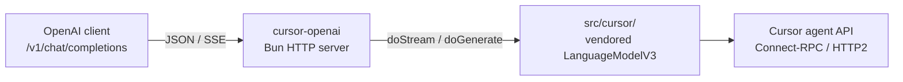

# Overview: OpenAI-compatible API over Cursor

**Status:** drafted (Phase 4 complete — see [04](./04-vendored-cursor-protocol.md))  
**Date:** 2026-07-26  
**Updated:** 2026-08-11

## Goal

Run a local (or self-hosted) **OpenAI-compatible HTTP API** that translates Chat Completions requests into Cursor’s agent protocol, so any OpenAI client can use Cursor subscription models.

## Decisions (locked)

| Decision | Choice |
|----------|--------|
| Primary clients | Any OpenAI-compatible client (curl, OpenAI SDK, Continue, Cline, LiteLLM, etc.) |
| MVP tools | Chat/text first; OpenAI tool pass-through in phase 2+ ([03](./03-future-tool-calling.md)) |
| Cursor integration | ~~Reuse npm package `cursor-opencode-provider` via `createCursor()`~~ **superseded:** vendored protocol in-repo (`src/cursor/`) — transport/translation only, zero context injection ([04](./04-vendored-cursor-protocol.md)) |
| Local clone | `./cursor-opencode-provider` is **reference only**, not a runtime dependency |
| Runtime | Bun (`Bun.serve`) |

## What `LanguageModelV3` means

Vercel’s **AI SDK** defines a provider contract (`@ai-sdk/provider`): a language model exposes `doGenerate` / `doStream` with a shared prompt format.

This repo vendors a Connect-RPC/protobuf agent protocol translator under `src/cursor/` that implements that contract. The OpenAI HTTP server (`src/bridge.ts`) stays unchanged and calls `doStream` / `doGenerate` directly.

```
OpenAI client  →  this project (HTTP)  →  LanguageModelV3 (src/cursor/)  →  Cursor agent API
```

## Architecture



Proxy owns transport + message/stream translation only. System prompt, workspace/context, and tool execution are always caller-owned (client request / client-side tools).

## Plan index

| Doc | Phase | Deliverable |
|-----|-------|-------------|
| [01-mvp-openai-bridge.md](./01-mvp-openai-bridge.md) | 1 | Working `/v1/chat/completions` + `/v1/models` (text only) |
| [02-auth-and-config.md](./02-auth-and-config.md) | 1 (parallel) | CLI `--auth`/`--api-key`, oauth refresh, proxy Bearer |
| [03-future-tool-calling.md](./03-future-tool-calling.md) | 2+ | OpenAI tool passthrough (post-MVP) |
| [04-vendored-cursor-protocol.md](./04-vendored-cursor-protocol.md) | 4 | Drop npm provider; vendored Cursor protocol with zero context injection (stateless multi-client) |

## Non-goals (near term)

- OpenCode plugin packaging for this repo
- Embeddings, images, Assistants API
- Full OAuth browser login UI in this repo (reuse keys / tokens already obtained via OpenCode / upstream login)
- Executing Cursor-native filesystem/shell tools on the proxy host (pass-through to the client only)
- Any proxy-owned workspace / `request_context` injection (see [04](./04-vendored-cursor-protocol.md))

## Risks

- **Private protocol / ToS** — same personal-use caveats as the upstream Cursor provider ecosystem; Cursor may change or restrict the API.
- **Vendored protocol maintenance** — ~8–9k LOC under `src/cursor/`; re-vendor against newer upstream tags via the forward-sync rule in `src/cursor/NOTICE.md`.
- **AI SDK type drift** — vendored V3-spec code compiles against `@ai-sdk/provider` V3 type aliases; bump the pin deliberately with typecheck as the gate.
- **HTTP/2** — requires a runtime where Node/Bun HTTP2 against Cursor works.
