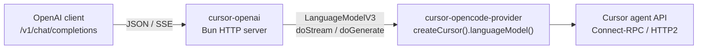

# Overview: OpenAI-compatible API over Cursor

**Status:** drafted  
**Date:** 2026-07-26

## Goal

Run a local (or self-hosted) **OpenAI-compatible HTTP API** that translates Chat Completions requests into Cursor’s agent protocol, so any OpenAI client can use Cursor subscription models.

## Decisions (locked)

| Decision | Choice |
|----------|--------|
| Primary clients | Any OpenAI-compatible client (curl, OpenAI SDK, Continue, Cline, LiteLLM, etc.) |
| MVP tools | Chat/text only — ignore or reject `tools` / `functions` |
| Cursor integration | Reuse npm package `cursor-opencode-provider` via `createCursor()` |
| Local clone | `./cursor-opencode-provider` is **reference only**, not a runtime dependency |
| Runtime | Bun (`Bun.serve`) |

## What `LanguageModelV3` means

Vercel’s **AI SDK** defines a provider contract (`@ai-sdk/provider`): a language model exposes `doGenerate` / `doStream` with a shared prompt format.

`cursor-opencode-provider` implements that contract and speaks Cursor’s Connect-RPC/protobuf agent protocol underneath. It is **not** an OpenAI HTTP server.

```
OpenAI client  →  this project (HTTP)  →  LanguageModelV3 (createCursor)  →  Cursor agent API
```

## Architecture



## Plan index

| Doc | Phase | Deliverable |
|-----|-------|-------------|
| [01-mvp-openai-bridge.md](./01-mvp-openai-bridge.md) | 1 | Working `/v1/chat/completions` + `/v1/models` (text only) |
| [02-auth-and-config.md](./02-auth-and-config.md) | 1 (parallel) | CLI `--auth`/`--api-key`, oauth refresh, proxy Bearer |
| [03-future-tool-calling.md](./03-future-tool-calling.md) | 2+ | OpenAI tool passthrough (post-MVP) |

## Non-goals (near term)

- Reimplementing Cursor protobuf framing (use the npm package)
- OpenCode plugin packaging for this repo
- Embeddings, images, Assistants API
- Full OAuth browser login UI in this repo (reuse keys / tokens the provider already accepts)
- Executing Cursor-native filesystem/shell tools locally

## Risks

- **Private protocol / ToS** — same personal-use caveats as `cursor-opencode-provider`; Cursor may change or restrict the API.
- **Model discovery not exported** — package root exposes `createCursor` + plugin, not AvailableModels; MVP uses cache/allowlist.
- **AI SDK version skew** — provider pins `LanguageModelV3` (`@ai-sdk/provider` 3.x); call `doStream`/`doGenerate` directly to avoid `ai` package V4 mismatch.
- **HTTP/2** — provider requires a runtime where Node/Bun HTTP2 against Cursor works.