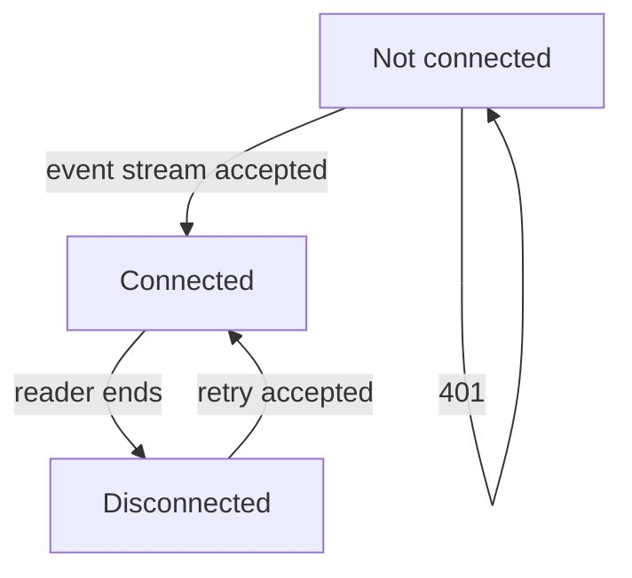
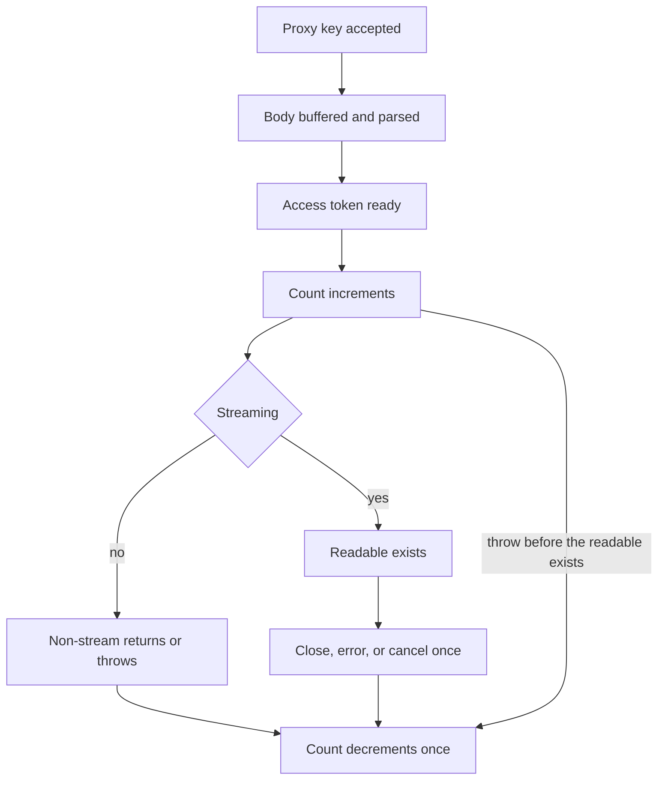

# Status page - Plan

## Goal Capsule

- **Objective:** While this proxy is running, an operator can see whether the live view is connected, whether a chat completion is in flight, and a recent list of calls with where each one came from and how large the request and response were.
- **Means:** The proxy serves that view on its existing port and streams it as server-sent events (KTD2, KTD1).
- **Authority:** Requirements win on behavior. Key technical decisions win on mechanism. Units override neither.
- **Execution profile:** Code change. `bun test src` and `bun run typecheck` are the automated proof. This repo has no browser runner.
- **Stop conditions:** Stop if a row would store prompt or response text. Stop if the view needs a second port or process. Stop if the proxy key would be placed in the page URL.
- **Finishes the work:** The implementer lands U1 through U4. The operator opens the page to confirm the bar, which the test runner does not draw.

---

## Product Contract

### Summary

The proxy will serve a status page on its current port. The page keeps a live view of recent chat completions: where each call came from, and the size of the request and response. The view updates over a server-sent event stream gated by the same proxy API key as chat completions.

### Problem Frame

Chat clients already call this proxy, and the process handles those calls, but nothing on the server shows an operator what just ran. Reading a client log or turning on provider debug is the only way to see traffic. Debug output is the wrong place for that, because it is off by default and it can contain prompt text.

### Key Decisions

- **Connection and in-flight only.** The bar shows whether the live view is up and whether a chat completion is in flight. Token refresh and upstream errors stay off the bar. (session-settled: user-approved — chosen over a bar that includes token refresh and upstream errors: the confirmed scope kept those off the bar) Governs R2, R8.
- **Address, requested model, and body bytes.** Each row is the client address, the model string the client sent, and the request and response body sizes in bytes. (session-settled: user-approved — chosen over token counts: the confirmed scope asked for size in and out) Governs R3, R5.
- **Same proxy API key.** The live rows require the proxy API key. A page left open like the health check would show caller addresses to anyone who can reach the port. (session-settled: user-approved — chosen over a public page: caller addresses would be visible on the network) Governs R1, R7.
- **Server-sent events.** The live view is a server-sent event stream. A browser navigation and a browser websocket cannot send the `Authorization` header this server already checks. Governs R4, R9.

### Requirements

**Page**

- R1. `GET /status` returns an HTML shell with an empty table, a status bar that is not connected, and a field for the proxy API key. The shell contains no call rows and no key.
- R2. The bar has three states driven by the live view: not connected, connected, and disconnected after a drop. While connected, it also shows whether any chat completion is in flight.
- R4. While the live view is open, the table and the in-flight state update without a reload.
- R9. A dropped live view retries with the key still held on the page. A 401 does not retry. Submitting the key again aborts the previous stream first. The last table stays until the next snapshot replaces it.

**Rows**

- R3. Each row shows the client address, the model string the client sent before normalization, the request body size in bytes, and the response body size in bytes. A model longer than 200 characters is stored as its first 200.
- R5. A row does not include prompt text, response text, or token counts.
- R6. The list is held in memory for the life of the process and is empty after a restart.
- R8. The in-flight state stays on until every accepted chat completion has finished, including overlapping streams.

**Access**

- R7. `GET /status/events` rejects a missing or wrong proxy API key with the existing 401 JSON and sends no rows. A chat rejected by that same check is not a row. A chat that passed the proxy key and later fails, including an upstream 401, is a row.

### Key Flows

- F1. Watch the proxy
  - **Trigger:** The operator opens `/status`.
  - **Actors:** The operator, and any client calling `POST /v1/chat/completions`.
  - **Steps:** The shell loads empty. The operator submits the key. The stream accepts and sends the current snapshot. Later calls update that snapshot on start and on finish. A drop retries. A wrong key shows the error and no rows.
  - **Covered by:** R1, R2, R4, R7, R9

### Acceptance Examples

- AE1. Wrong key shows no rows
  - **Covers:** R1, R7
  - **Given:** The proxy key is `proxy-secret` and one chat has already been recorded.
  - **When:** The operator submits `nope`.
  - **Then:** The events response is the existing 401 JSON, the bar stays not connected, the table stays empty, and `error.message` is shown by the form.
- AE2. Overlapping streams hold the bar
  - **Covers:** R8
  - **Given:** The live view is connected and the in-flight count is 0.
  - **When:** Two streaming chats are in progress at once, and the first one finishes.
  - **Then:** The bar stays in flight until the second stream finishes.
- AE3. Bad JSON is still a row
  - **Covers:** R3, R7
  - **Given:** The request has a valid proxy key and the body is not JSON.
  - **When:** The handler answers 400.
  - **Then:** One row is stored with an empty model, the buffered request length, and the error JSON length.
- AE4. Requested model is not rewritten
  - **Covers:** R3
  - **Given:** A valid chat whose model field is `cursor/auto`.
  - **When:** The row is stored.
  - **Then:** The model cell is `cursor/auto`.
- AE5. Restart clears the list
  - **Covers:** R6
  - **Given:** The process had rows, then it restarted.
  - **When:** The operator connects again with the right key.
  - **Then:** The first snapshot has an empty row list and in-flight is false.

### Scope Boundaries

- The shell HTML is public and empty. Call rows leave the process only on `GET /status/events` after the proxy key check.
- Prompt text, response text, token counts, charts, and a disk log are out.
- Chat completion auth stays `Authorization: Bearer` only. Cursor oauth is a different credential and is not the page gate.
- The listen port, the HTTP `idleTimeout` of 255 seconds, and the Docker publish of that single port stay as they are.

#### Deferred to Follow-Up Work

- A session cookie that would keep the proxy key out of page script.
- A per-row running marker when several calls overlap.
- History that survives a restart.

---

## Planning Contract

### Key Technical Decisions

- KTD1. The page reads the event stream with `fetch` and `Authorization: Bearer`, using `requireProxyApiKey` unchanged. `EventSource` cannot set that header. A browser websocket cannot either, and on Bun 1.3 `server.upgrade` after an `await` is unsafe, so this plan does not upgrade. (session-settled: user-approved — chosen over a public page: caller addresses would be visible on the network) The key stays in a page variable until reload or a new submit. It is not written to the URL, `localStorage`, or `sessionStorage`. A random session cookie would keep that key out of page script. This plan does not add that second gate. Row cells are text, so a model string cannot run as HTML and read the key. Governs the mechanism for R1, R7, R9.
- KTD2. `GET /status` is the shell, with `Content-Type: text/html; charset=utf-8` and no auth check. `GET /status/events` is `text/event-stream` with the chat stream's cache and connection headers, and it requires the proxy key. Neither response sends `corsHeaders()`. The page is same-origin, and `Access-Control-Allow-Origin: *` on this stream would let any other site that learned the key read caller addresses. The existing `OPTIONS` branch stays first and unauthenticated. Each `data:` event is one JSON object for the whole list plus whether the in-flight count is greater than zero, so a model containing a newline or `data:` stays inside a string. The first write on connect is that snapshot, including an empty list. Later writes happen when a counted call starts and when it finishes, not on each token. Comment heartbeats use the existing `: keep-alive\n\n` string on an 8000 ms timer per subscriber, so a quiet stream survives the 255 second HTTP idle timeout. The client ignores blocks whose lines start with `:`.
- KTD3. The in-flight count increments only after `getAccessToken` resolves and immediately before `handleChatCompletion`. A refresh throw is still a row, because the proxy key already passed, and it does not change the count. For `stream: true`, the decrement latch arms only after the `ReadableStream` exists. A throw between increment and that return decrements once in the handler. `close`, `error`, and `cancel` share one latch. A non-stream call decrements when `handleChatCompletion` returns or throws and never arms the latch. Overlap is why this is a count. `scripts/live-parallel.ts` runs more than one stream at once.
- KTD4. Request bytes are the length of the buffered POST body. The chat route reads that buffer, then parses JSON, instead of `req.json()`, which drops the bytes. The buffer is discarded after parse. Response bytes for a thrown failure are the UTF-8 length of the `errorResponse` JSON, and that string is the response body. Response bytes for a non-stream success are the UTF-8 length of the JSON actually returned. Response bytes for a stream are the sum of every `controller.enqueue` in `handleChatCompletion`, including heartbeats, error frames, and both `data: [DONE]\n\n` writes. The handler does not read the chat `Response` body to measure it.
- KTD5. The client address is `server.requestIP(req).address`, captured in the `startServer` fetch wrapper before the first `await`. `createHandler` takes that string as an optional argument so existing `handler(new Request(...))` tests stay valid and see an empty address. A null `requestIP` is stored as `""`. The plan does not read `X-Forwarded-For`. When `parseChatCompletionRequest` does not return, the model cell is `""`. When it returns, the cell is `parsed.model` before `normalizeModelId`, cut to 200 characters per R3.
- KTD6. The ring cap is 100 rows for one handler. Drop the oldest finished row first. An in-flight row that falls out is not inserted again at finish. Its count still decrements. Response-byte updates after eviction are ignored. The ring and its subscribers live on the `createHandler` closure, not a module global, so tests do not share rows.
- KTD7. The snapshot parser lives in one browser-safe module with no Node imports. Tests import it. The HTML shell inlines that module's source into a script tag, so the browser runs the same parser and there is no second URL. The parser skips comment blocks. The page sets row cells with text nodes. The key field is `type=password` with `autocomplete=off`. A 401 leaves the bar not connected and shows `error.message` beside the form. After a successful connect, a reader that ends moves the bar to disconnected and retries with backoff until the page is closed or the user submits a different key. The previous `fetch` is aborted first.

### High-Level Technical Design

The bar follows the status `fetch`, not chat upstream errors.

The count follows the chat POST, not the moment `handleChatCompletion` returns a stream `Response`.

A publish builds one snapshot string and enqueues it on each subscriber inside its own try/catch. A throw removes that subscriber and clears its timer. The exception does not leave the publish function. If a subscriber is backed up, skip the intermediate snapshot and keep the latest one. Chat does not wait for the browser.

### System-Wide Impact

- `/health` and `GET /status` stay outside `requireProxyApiKey`. `GET /status/events` uses that check. Cursor oauth is not a second gate (R7, KTD1).
- `OPTIONS` stays the first branch and still answers 204 before any path check. Status GET responses do not add `corsHeaders()` (KTD2).
- `index.ts` calls `auth.stop()`, then `server.stop()`, then `process.exit(0)`, and it does not await `server.stop()`. Leave that order. Waiting for stop while a status stream is open holds the process.
- HTTP `idleTimeout` stays 255. Status heartbeats and chat heartbeats are different sockets (KTD2).
- The Dockerfile keeps one published port. Anyone who can open `/health` on that mapping can also open the empty shell.
- A chat POST updates the ring and returns without waiting for a status subscriber to read (KTD2). Any holder of the proxy key can read every caller address. That is the same key chat clients already have. This plan does not add a second page credential.

### Sequencing

U1 stands alone. U2 records real chats into that ring and should land before U3, because both edit `src/server.ts`. U4 builds the page on the stream from U3.

### Risks & Dependencies

- A `finally` around `return await handleChatCompletion` clears the bar while a stream is still open. KTD3 is the counter to that.
- Storing the raw POST buffer, or publishing on every SSE enqueue, either leaks prompt text into memory for the life of the call or stalls chat on a slow page. Measure, drop the buffer, and publish only on start and finish (KTD4, KTD2).
- `mapProviderError` can turn a Cursor auth failure into HTTP 401 after the proxy key was accepted. Treating every 401 as "not a row" drops those calls. R7 keeps them.
- The model string is caller-controlled. Building row HTML with `innerHTML` would run it on the status origin, next to the in-memory key. KTD7 uses text nodes. A model of `</script>` must not close the inlined parser.
- The process listens on all interfaces with no TLS, and a retry sends the key again. The README already limits this to a trusted network. Listing the new routes does not drop that sentence.
- Bun's HTTP `idleTimeout` of 255 seconds closes a status stream that does not write. Chat heartbeats do not keep that stream warm. KTD2 gives the status stream its own 8000 ms comment timer.
- This plan depends on the existing `requireProxyApiKey`, `errorResponse`, `corsHeaders`, and the chat SSE heartbeat in `src/bridge.ts`. It does not add a package.

### Sources

- `src/server.ts` routes `GET /health`, `GET /v1/models`, and `POST /v1/chat/completions` inside `createHandler`. `startServer` passes that function to `Bun.serve` with `idleTimeout: 255` and does not keep the server argument.
- `src/auth.ts` `requireProxyApiKey` accepts only `Authorization: Bearer`.
- `src/bridge.ts` returns a `ReadableStream` for `stream: true` after `doStream` resolves. Heartbeats, payload frames, and `data: [DONE]\n\n` are separate `enqueue` sites. `cancel` is empty today.
- `src/openai/request.ts` sets `model` to the trimmed client string. `src/models.ts` `normalizeModelId` rewrites that string later.
- `src/errors.ts` `errorResponse` is the 401 and 400 JSON body. `corsHeaders` allows `Authorization` and `Access-Control-Allow-Origin: *`.
- `package.json` test script is `bun test src`. `src/server.test.ts` calls `createHandler` with `new Request`. One test already listens with `Bun.serve({ port: 0 })`.
- Bun 1.3 documents `server.upgrade` on the same `Bun.serve` listener. The 1.4.1 fix for upgrade-after-await is not in the `oven/bun:1.3` image this repo ships. That is why the live view stays a `Response`.
- RFC 6750 section 2.3 says not to put a bearer token in a URL. Section 5.3 says not to store bearer tokens in cookies sent in the clear. The page therefore keeps the key in memory and sends it as a header.

---

## Implementation Units

### U1. In-memory call ring

**Goal:** Hold recent call rows and an in-flight count for one handler, and build a snapshot that contains neither prompt text nor token counts.

**Requirements:** R3, R5, R6, R8

**Dependencies:** None

**Files:** `src/status-log.ts`, `src/status-log.test.ts`

**Approach:**

1. A row is client address, model, request bytes, and response bytes. No other fields.
2. Follow KTD6 for the cap, eviction, and the rule that an evicted in-flight row is not restored at finish.
3. `inFlight` on the snapshot is `count > 0`.
4. The operations are record, start, and finish. An optional `onChange` runs after each one and receives the snapshot only, the same shape as `onSession` in `src/cursor/pump.ts`. U3 passes that callback. U2 does not.

**Patterns to follow:** `src/status-log.test.ts` uses `bun:test` the same way `src/server.test.ts` does. Keep the module free of `Bun.serve`.

**Test scenarios:**

- Happy path: start one call with address `127.0.0.1`, model `composer-2.5`, request bytes 40. The snapshot shows that row, response bytes 0, and `inFlight` true. Finish it with response bytes 90. `inFlight` is false and the row keeps 90.
- Edge: the 101st finished row drops the oldest finished row. Length stays 100.
- Edge: a model of 250 `a` characters is stored as 200 characters (R3).
- Edge: when the oldest row is in flight and a finished row exists, the finished row is the one dropped.
- Edge: finishing an id that was already evicted does not insert a row, and the count still decrements.
- Error path: a second finish for the same id does not decrement twice.
- Integration: the snapshot object has no field whose value is a prompt or an assistant string. Passing those strings into the record function is not possible from its arguments.

**Verification:** `src/status-log.test.ts` passes, and the module does not import the chat handler.

### U2. Record each chat completion

**Goal:** Every `POST /v1/chat/completions` that passed the proxy key becomes one row with the right bytes, and the in-flight count matches KTD3.

**Requirements:** R3, R5, R7, R8

**Dependencies:** U1

**Files:** `src/server.ts`, `src/bridge.ts`, `src/server.test.ts`, `src/bridge.test.ts`

**Approach:**

1. In the `startServer` fetch wrapper, read `requestIP` before `await` and pass the address into the handler (KTD5).
2. On the chat POST, after `requireProxyApiKey`, buffer the body and parse it (KTD4). Failures after that check call the ring. The shared `catch` at the bottom of `createHandler` must not be the only logger, or `/v1/models` failures become rows too.
3. Increment and decrement per KTD3. `handleChatCompletion` gains an optional observer whose argument is the byte length of one enqueue, including heartbeats, the same kind of optional field as `heartbeatIntervalMs`. Callers that omit it stay valid. The observer does not receive the encoded frame.
4. Call the ring operations from U1. Do not walk subscribers here. U3's `onChange` publishes.

**Patterns to follow:** `src/server.test.ts` builds `createHandler(baseConfig, authStub)` and sends `new Request`. `src/bridge.test.ts` already waits on a short heartbeat and expects `: keep-alive` before a late delta. Extend that style rather than reading the stream inside `createHandler`.

**Test scenarios:**

- Happy path: a non-stream POST with a valid key and model `composer-2.5` stores one row. Response bytes equal the UTF-8 length of the JSON body. The count is 0 after the handler returns.
- Happy path: a stream fixture's response bytes include the heartbeat frame and `data: [DONE]\n\n`.
- Edge: model `cursor/auto` is stored as `cursor/auto`.
- Edge: a POST with a valid key and body `not-json` stores one row with model `""`, request bytes equal to that buffer, and response bytes equal to the 400 JSON from `errorResponse`.
- Error path: the same body with the wrong key stores nothing and does not change the count.
- Error path: `getAccessToken` rejects after a valid parse. One row is stored and the count stays 0.
- Error path: `doStream` throws before a `ReadableStream` exists. The count returns to 0.
- Integration: two overlapping delayed streams keep `inFlight` true after the first finishes, and false only after the second finishes.
- Integration: a `Bun.serve` on port 0, following the existing refresh test, records `127.0.0.1` for a localhost POST. A `createHandler` call that omits the address stores `""`.

**Verification:** The new cases in `src/server.test.ts` and `src/bridge.test.ts` pass. Existing chat tests still pass without supplying the observer.

### U3. Status routes and live snapshots

**Goal:** Serve the empty shell and a bearer-gated event stream that starts with the current snapshot and updates on call start and finish.

**Requirements:** R1, R4, R6, R7

**Dependencies:** U1, U2

**Files:** `src/server.ts`, `src/server.test.ts`, `README.md`

**Approach:**

1. Register `GET /status` and `GET /status/events` before the 404 (KTD2). Log both next to the existing routes in `startServer`. Do not add `corsHeaders()` on either response.
2. The shell response is HTML with an empty table. It does not read the ring into the document.
3. Pass `onChange` once where the handler creates the ring. The events route calls `requireProxyApiKey`, then returns a `ReadableStream`. Register the subscriber and enqueue the first snapshot with no `await` between them.
4. `onChange` publishes one snapshot (KTD2). A subscriber whose enqueue throws is removed. A chat POST still returns.
5. Each subscriber has its own 8000 ms heartbeat timer, cleared on cancel.

**Patterns to follow:** Match the chat `Response` headers in `handleChatCompletion` for the event stream. Match `errorResponse` for a missing key. Do not add a route table. `createHandler` stays an if-chain.

**Test scenarios:**

- Happy path: `GET /status` is 200 HTML, the body contains no `proxy-secret`, and a prior POST whose model is `</script>` does not put that string in the HTML. The response has no `Access-Control-Allow-Origin` header.
- Happy path: `GET /status/events` with `Authorization: Bearer proxy-secret` is `text/event-stream`, and the first `data:` event is an empty snapshot with `inFlight` false.
- Happy path: after a recorded chat, a new events request's first snapshot contains that row.
- Error path: `GET /status/events` with no header is status 401 and the current JSON shape from the existing "POST without credentials" test, and it adds no row. The events response has no `Access-Control-Allow-Origin` header.
- Edge: the event bytes contain `: keep-alive\n\n` and the stream stays open, following the bridge test that expects a heartbeat comment before a late delta.
- Integration: a subscriber that throws on enqueue does not fail a later `POST /v1/chat/completions`. That subscriber receives no further snapshots.
- Integration: `GET /health` and `GET /v1/models` keep their current auth and status codes.

**Verification:** `src/server.test.ts` covers the two new routes. `README.md` lists `GET /status` and `GET /status/events` beside the existing endpoints.

### U4. Page script

**Goal:** The shell submits the key, renders snapshots as text, and recovers from a dropped stream per R9.

**Requirements:** R1, R2, R4, R9

**Dependencies:** U3

**Files:** `src/status-snapshot.ts`, `src/status-snapshot.test.ts`, `src/status-page.ts`, `src/server.ts`

**Approach:**

1. Follow KTD7. `src/status-snapshot.ts` parses a byte stream into snapshots and ignores comment blocks. It imports nothing from Node.
2. `src/status-page.ts` returns the HTML string. The script tag contains the parser module source. The table is filled with text nodes. The bar text comes from the `fetch` lifecycle plus `inFlight`.
3. Wire `GET /status` to that HTML builder. U3's route test should then assert on this document.

**Patterns to follow:** Keep the page free of a framework. Tests read handler bytes or call the parser directly, the same way `src/server.test.ts` reads `res.text()`.

**Test scenarios:**

- Happy path: bytes for `: keep-alive\n\n` followed by a `data:` snapshot parse to that snapshot and do not throw.
- Happy path: a snapshot with model `` is returned as that string. The HTML builder's script assigns row cells with `textContent` or `createTextNode`, which the test checks by reading the script source.
- Edge: an empty `data:` snapshot parses to an empty row list and `inFlight` false.
- Edge: a snapshot whose model contains a newline and the characters `data:` parses as one field on one event (KTD2).
- Error path: a block that is only the comment heartbeat leaves the previous snapshot in place.
- Integration: `GET /status` body includes a password field with `autocomplete=off`, includes the parser source, and does not include `proxyApiKey` or a hardcoded model id from a test POST.

**Verification:** `src/status-snapshot.test.ts` passes, and the `/status` assertion in `src/server.test.ts` matches the builder output.

---

## Verification Contract

| Check | Command | Applies to |
|---|---|---|
| Unit and route tests | `bun test src` | U1, U2, U3, U4 |
| Types | `bun run typecheck` | U1, U2, U3, U4 |

`bun test src` is the `package.json` test script. There is no browser project to run. AE1's rendered bar and AE2's on-screen hold are covered in logic by the parser tests and the overlapping-stream test. The operator confirms the drawn bar by opening `/status`.

---

## Definition of Done

- U1 through U4 meet their verification lines, and `bun test src` and `bun run typecheck` pass.
- A row payload cannot carry prompt text, response text, or token counts (R5).
- `GET /health` remains unauthenticated. Chat completions still require the bearer key.
- `README.md` lists the two new routes.
- Abandoned experiments are not left in the diff.
